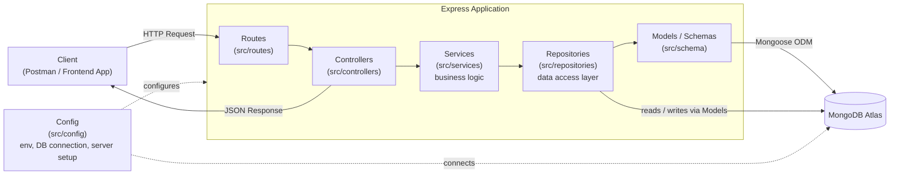

# 🍕 Pizza App Backend

A Node.js + Express + MongoDB REST API backend for a pizza ordering application, built around the **MVC (Model–View–Controller)** architectural pattern (View is replaced by JSON API responses, as is standard for a backend-only service).

> **Project status:** Early-stage / actively under development. The foundational layers (server bootstrap, configuration, database connection) are in place, and the data/controller/route layers are being built out next. See [Current Structure](#-current-structure) and [Planned Architecture](#-planned-architecture-mvc) below for exactly what exists today vs. what's coming.

---

## Tech Stack

| Layer            | Technology                          |
|-------------------|--------------------------------------|
| Runtime            | Node.js                             |
| Web Framework      | [Express](https://expressjs.com/) v5 |
| Database           | [MongoDB](https://www.mongodb.com/) via [Mongoose](https://mongoosejs.com/) |
| Config Management  | [dotenv](https://www.npmjs.com/package/dotenv) |
| Dev Tooling        | [nodemon](https://www.npmjs.com/package/nodemon) |

---

## Planned Architecture (MVC)

The backend follows the MVC pattern adapted for REST APIs:

- **Model / Schema** — Mongoose schemas that define the shape of data (Users, Pizzas, Orders, etc.) and are the layer that actually talks to MongoDB.
- **Repository** — Data-access layer that wraps all database queries (find, create, update, delete) using the Models. Services never query Mongoose directly — they go through the repository.
- **Service** — Business logic layer. Talks to the repository to fetch/persist data, applies business rules, and hands the result back to the controller.
- **Controller** — Sits between routes and services: validates input, calls the appropriate service, and shapes the HTTP response.
- **Route** — Express routers that map HTTP endpoints (`GET /pizzas`, `POST /orders`, ...) to their controller functions.
- **View** — Replaced by JSON responses, since this is an API-only backend (no server-rendered templates).



**Request flow:** `Client → Route → Controller → Service → Repository → Model (Schema) → MongoDB`, and the response travels back the same path as JSON.

---

## Current Structure

This is what actually exists in the repository right now:

```
PIZZA_APP_BACKEND/
├── src/
│   ├── index.js              # App entry point — wires up middleware, starts the server, connects to DB
│   ├── config/
│   │   ├── serverConfig.js   # Reads PORT and DB_URL from environment variables
│   │   └── dbConfig.js       # Establishes the Mongoose connection to MongoDB
│   └── schema/
│       └── userSchema.js     # Mongoose schema for User (in progress)
├── .env.example               # Template for required environment variables
├── .gitignore
├── package.json
└── README.md
```

### What each piece does (in plain language)

- **`src/index.js`** — The starting point of the app. It creates the Express server, tells it to understand JSON and form data sent by clients, and starts listening for requests on the configured port. It also triggers the database connection when the server boots up.
- **`src/config/serverConfig.js`** — Centralizes environment-based settings (like which port to run on and the database URL) so the rest of the app never reads `process.env` directly.
- **`src/config/dbConfig.js`** — Handles connecting to the MongoDB database using Mongoose, and logs whether that connection succeeded or failed.
- **`src/schema/userSchema.js`** — Where the data model for a `User` (name, email, password, orders, etc.) will be defined using Mongoose. This is the first of several planned schemas (Pizza, Order, Cart, ...).

### Coming next

- `src/routes/` — API route definitions (e.g. `/api/users`, `/api/pizzas`, `/api/orders`)
- `src/controllers/` — Request handling for each route
- `src/services/` — Business logic, called by controllers
- `src/repositories/` — Data-access layer that wraps all Mongoose/DB queries, called by services
- `src/models/` (or expanded `src/schema/`) — Mongoose models for Pizza, Order, Cart, Category
- `src/middlewares/` — Auth guards, error handling, request validation
- Authentication (JWT-based login/signup)
- Order management and cart flow

---

## Getting Started

### Prerequisites

- [Node.js](https://nodejs.org/) (v18+ recommended)
- A [MongoDB](https://www.mongodb.com/atlas) database (local or Atlas)

### Installation

```bash
# 1. Clone the repository
git clone https://github.com/samsang-59/Pizza_APP_BACKEND.git
cd Pizza_APP_BACKEND

# 2. Install dependencies
npm install

# 3. Configure environment variables
cp .env.example .env
# then fill in your own values in .env
```

### Environment Variables

Create a `.env` file in the project root (see `.env.example`):

| Variable | Description |
|----------|-------------|
| `PORT` | Port the Express server listens on |
| `DB_URL` | MongoDB connection string |

> `.env` is git-ignored — never commit real credentials.

### Running the app

```bash
# Development (auto-restarts on file changes)
npm run dev

# Production
npm start
```

The server will start on `http://localhost:<PORT>` and log a message once it successfully connects to MongoDB.

---

## Contributing

This project is a personal learning/portfolio build. Suggestions and feedback are welcome via issues or pull requests.

## License

Licensed under the [ISC License](LICENSE).
