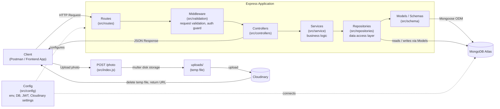

> **SkyTrace AI (hackathon prototype) also lives in this repository** — see [SKYTRACE.md](SKYTRACE.md).
> **Download the ready-to-run app:** https://github.com/samsang-59/Pizza_APP_BACKEND/releases/latest
> Run the complete app with `./start-skytrace.sh` (or `.\start-skytrace.ps1`, or `docker build -t skytrace-ai . && docker run -p 8000:8000 skytrace-ai`) and open http://localhost:8000.

# 🍕 Pizza App Backend

A Node.js + Express + MongoDB REST API backend for a pizza ordering application, built around the **MVC (Model–View–Controller)** architectural pattern (View is replaced by JSON API responses, as is standard for a backend-only service).

> **Project status:** Early-stage / actively under development. The full request pipeline (Route → Controller → Service → Repository → Model → DB) is wired up end-to-end for the **User** resource (registration) and **Auth** (login with JWT, cookie-based sessions, route protection). Image upload to Cloudinary is also working (`POST /photo`). A **Product** schema exists but isn't wired up to a route/controller yet. Additional resources (Pizza, Order, Cart) are still to come. See [Current Structure](#-current-structure) below for exactly what exists today vs. what's coming.

---

## Tech Stack

| Layer            | Technology                          |
|-------------------|--------------------------------------|
| Runtime            | Node.js                             |
| Web Framework      | [Express](https://expressjs.com/) v5 |
| Database           | [MongoDB](https://www.mongodb.com/) via [Mongoose](https://mongoosejs.com/) |
| Config Management  | [dotenv](https://www.npmjs.com/package/dotenv) |
| Password Hashing   | [bcrypt](https://www.npmjs.com/package/bcrypt) |
| Authentication     | [jsonwebtoken](https://www.npmjs.com/package/jsonwebtoken) (JWT), [cookie-parser](https://www.npmjs.com/package/cookie-parser) |
| File Upload         | [multer](https://www.npmjs.com/package/multer) (disk storage) + [Cloudinary](https://cloudinary.com/) (image hosting) |
| Dev Tooling        | [nodemon](https://www.npmjs.com/package/nodemon) |

---

## Architecture (MVC + Service/Repository)

The backend follows the MVC pattern adapted for REST APIs, with an added Service and Repository layer to keep business logic and database access cleanly separated:

- **Model / Schema** — Mongoose schemas that define the shape of data (Users, Pizzas, Orders, etc.) and are the layer that actually talks to MongoDB.
- **Repository** — Data-access layer that wraps all database queries (find, create, update, delete) using the Models. Services never query Mongoose directly — they go through the repository.
- **Service** — Business logic layer. Talks to the repository to fetch/persist data, applies business rules, and hands the result back to the controller.
- **Controller** — Sits between routes and services: calls the appropriate service and shapes the HTTP response.
- **Route** — Express routers that map HTTP endpoints (`GET /pizzas`, `POST /orders`, ...) to their controller functions, running any middleware first.
- **Middleware** — Cross-cutting checks that run before a controller: request validation (`authValidator`, which requires an email/password body) and auth guards (`isLoggedIn`, which verifies the JWT cookie).
- **View** — Replaced by JSON responses, since this is an API-only backend (no server-rendered templates).



**Request flow:** `Client → Route → Middleware (validation/auth) → Controller → Service → Repository → Model (Schema) → MongoDB`, and the response travels back the same path as JSON.

> `POST /photo` is currently defined directly in `src/index.js` as a quick proof-of-concept for the Multer → Cloudinary upload flow, rather than going through the full route/controller/service layering above. It's a candidate for being moved into its own route/controller once a `Product` (or dedicated `Upload`) resource is wired up.

---

## Current Structure

This is what actually exists in the repository right now:

```
PIZZA_APP_BACKEND/
├── src/
│   ├── index.js                    # App entry point — wires up middleware, mounts routes, starts the server, connects to DB
│   ├── config/
│   │   ├── serverConfig.js         # Reads PORT, DB_URL, JWT, and Cloudinary settings from environment variables
│   │   ├── dbConfig.js             # Establishes the Mongoose connection to MongoDB
│   │   └── cloudinaryConfig.js     # Configures the Cloudinary SDK using env credentials
│   ├── routes/
│   │   ├── userRoute.js            # Maps /user endpoints to their controller functions
│   │   └── authRoute.js            # Maps /login endpoint to its middleware + controller
│   ├── controllers/
│   │   ├── userController.js       # Handles the HTTP request/response for user endpoints
│   │   └── authController.js       # Handles the HTTP request/response for login, sets the auth cookie
│   ├── service/
│   │   ├── userService.js          # Business logic for users (e.g. duplicate-user checks on registration)
│   │   └── authService.js          # Business logic for login (credential check, JWT issuing)
│   ├── repositories/
│   │   └── userRepository.js       # Data-access layer — all Mongoose queries for the User model live here
│   ├── validation/
│   │   └── authValidator.js        # Middleware: validates the login request body, and verifies the JWT auth cookie
│   ├── middlewares/
│   │   └── multer_middleware.js    # Multer disk-storage config for handling incoming file uploads
│   └── schema/
│       ├── userSchema.js           # Mongoose schema/model for User (name, email, mobile, password)
│       └── productSchema.js        # Mongoose schema for Product (in progress — not yet wired to a route)
├── uploads/                          # Temp storage for files mid-upload (git-ignored, cleared after each Cloudinary upload)
├── .env.example                     # Template for required environment variables
├── .gitignore
├── package.json
└── README.md
```

### What each piece does (in plain language)

- **`src/index.js`** — The starting point of the app. It creates the Express server, tells it to understand JSON, form data, and cookies sent by clients, mounts the `/user`, `/login`, and `/photo` routes, and starts listening for requests on the configured port. It also triggers the database connection when the server boots up.
- **`src/config/serverConfig.js`** — Centralizes environment-based settings (port, database URL, JWT secret/expiry, Cloudinary credentials) so the rest of the app never reads `process.env` directly.
- **`src/config/dbConfig.js`** — Handles connecting to the MongoDB database using Mongoose, and logs whether that connection succeeded or failed.
- **`src/config/cloudinaryConfig.js`** — Configures the Cloudinary SDK with the cloud name/API key/secret so the rest of the app can just call `cloudinary.uploader.upload(...)`.
- **`src/routes/userRoute.js`** — Defines the `/user` endpoints (currently `POST /user` to register) and points each one at its controller function.
- **`src/routes/authRoute.js`** — Defines the `/login` endpoint and runs it through the validation/auth middleware before reaching the controller.
- **`src/controllers/userController.js`** — Receives the HTTP request, hands it off to the service layer, and formats a consistent JSON response (`{ success, message, data, error }`) whether the operation succeeds or fails.
- **`src/controllers/authController.js`** — Receives the login request, calls the auth service to get back a JWT, and sets it as an `httpOnly` cookie (`AuthToken`) on the response.
- **`src/service/userService.js`** — Contains the actual business rule for registration: check whether a user with the same email/mobile number already exists before creating a new one. Talks only to the repository, never to Mongoose directly.
- **`src/service/authService.js`** — Contains the login logic: look up the user by email, compare the submitted password against the bcrypt hash, and sign a JWT if it matches.
- **`src/repositories/userRepository.js`** — The only place that runs Mongoose queries (`findOne`, `create`) against the `User` model. Keeps database access isolated from business logic.
- **`src/validation/authValidator.js`** — Exports two middlewares: `authValidator` (rejects login requests missing an email/password) and `isLoggedIn` (verifies the `AuthToken` JWT cookie and attaches the decoded user to `req.user`).
- **`src/middlewares/multer_middleware.js`** — Configures Multer to save uploaded files to a local `uploads/` folder with a timestamped filename, before they're forwarded to Cloudinary.
- **`src/schema/userSchema.js`** — The Mongoose schema/model for `User`: first name, last name, mobile number, email, and password, with validation (required fields, length limits, uniqueness, email format). A `pre('save')` hook hashes the password with bcrypt before it's written to the database, so plaintext passwords are never stored.
- **`src/schema/productSchema.js`** — The intended Mongoose schema for `Product` (name, description, image, price, category, stock status). Still a work in progress and not yet connected to a repository/service/route.

### Coming next

- Wire up the `Product` schema (fix, then add repository/service/controller/route) and other resources: Order, Cart, Category
- Apply `isLoggedIn` to protect user/order-specific routes (currently only wired into the login route)
- Centralized error handling middleware
- Order management and cart flow

---

## API Endpoints

| Method | Endpoint | Description | Body |
|--------|----------|--------------|------|
| `POST` | `/user`  | Register a new user | `{ "firstName", "lastName", "email", "mobileNumber", "password" }` |
| `POST` | `/login` | Log in and receive an `AuthToken` cookie (JWT) | `{ "email", "password" }` |
| `POST` | `/photo` | Upload an image to Cloudinary | `multipart/form-data` with a `photo` file field |

All `/user` and `/login` responses follow the same shape:

```json
{
  "success": true,
  "message": "Successfully created user",
  "data": { "...": "..." },
  "error": {}
}
```

---

## Getting Started

### Prerequisites

- [Node.js](https://nodejs.org/) (v18+ recommended)
- A [MongoDB](https://www.mongodb.com/atlas) database (local or Atlas)

### Installation

```bash
# 1. Clone the repository
git clone https://github.com/samsang-59/Pizza_APP_BACKEND.git
cd Pizza_APP_BACKEND

# 2. Install dependencies
npm install

# 3. Configure environment variables
cp .env.example .env
# then fill in your own values in .env
```

### Environment Variables

Create a `.env` file in the project root (see `.env.example`):

| Variable | Description |
|----------|-------------|
| `PORT` | Port the Express server listens on |
| `DB_URL` | MongoDB connection string |
| `JWT_SECRET` | Secret key used to sign/verify login JWTs |
| `JWT_EXPIRY` | JWT expiry duration (e.g. `7d`) |
| `COUDINARY_CLOUD_NAME` | Cloudinary cloud name (note: this env var name is misspelled in the code, kept as-is here to match) |
| `CLOUDINARY_API_KEY` | Cloudinary API key |
| `CLOUDINARY_API_SECRET` | Cloudinary API secret |

> `.env` is git-ignored — never commit real credentials.

### Running the app

```bash
# Development (auto-restarts on file changes)
npm run dev

# Production
npm start
```

The server will start on `http://localhost:<PORT>` and log a message once it successfully connects to MongoDB.

---

## Contributing

This project is a personal learning/portfolio build. Suggestions and feedback are welcome via issues or pull requests.

## License

Licensed under the [ISC License](LICENSE).
